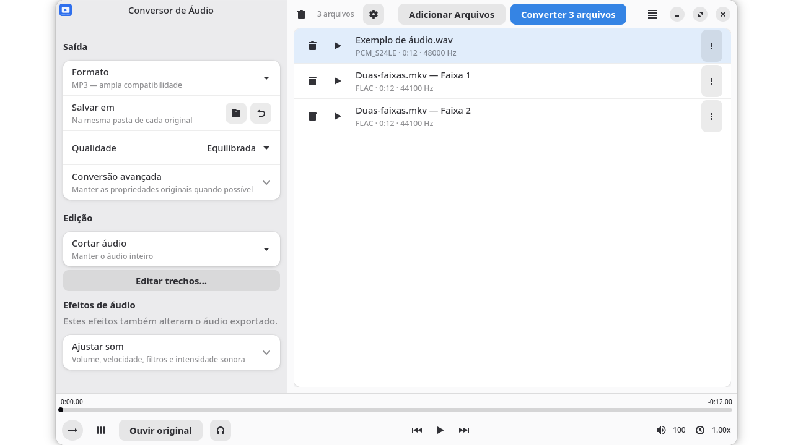

# Big Audio Converter

Convert audio files, extract audio tracks from videos and save selected sections on Linux. The interface uses GTK4 and libadwaita.



## Install and open

On BigLinux, install **Big Audio Converter** from the software manager and open it from the applications menu. The package command is `big-audio-converter-gui`.

Required components: Python 3.10 or newer, GTK 4.12 or newer, libadwaita 1.7 or newer, PyGObject, Pycairo, NumPy, FFmpeg/FFprobe, mpv and python-mpv. Speech noise reduction additionally requires one of the optional LADSPA packages listed below; an unavailable mode identifies the package to install.

## Convert files

1. Select **Add Files**, or drag local audio or video files into the window. Videos with multiple audio tracks get a separate entry for each track.
2. Choose **Format** and **Quality**, the two tiles at the top of the sidebar; each opens its choices as the pointer rests on it. MP3 is widely compatible. FLAC preserves decoded audio without loss, while WAV stores uncompressed audio. M4A, Opus and Ogg Vorbis are also available.
3. Check where the files go, below the queue as in Big Video Converter. By default, each result goes beside its original; **Folder to save** picks another one.
4. Select **Convert**. Each entry shows its progress, and the queue header counts the files done. When the batch ends, a banner above the queue shows the output folder, or offers **Try Again** for the files that were not converted. An entry's status icon explains its failure or warnings; its folder button shows its output.

While a batch runs, the settings and the queue wait; listening stays available, and the computer does not suspend. The inputs stay in the list. Existing files are never overwritten: conflicting output names receive a numeric suffix. **Cancel** waits for the worker to stop and removes unfinished output. Removing an entry (its **×** button, or Delete on the focused entry) does not delete its source; **Move to Trash**, in the entry's menu, is a separate, confirmed action. **Clear Queue**, in the main menu, asks first only when entries have marked parts.

In a narrow window the sidebar folds away; the button at the start of the queue header shows it and counts the active adjustments.

**Channels** and **Sample rate** sit under **Format** and **Quality**, with **Standard volume** and **Lift quiet parts** (Off, Light, Medium or Strong) below them. A setting's card opens beside the sidebar as the pointer rests on its tile, or on a click; a tile that cannot apply yet says why in place of its value. Original properties are preserved where the selected format supports them. If conversion requires resampling or a precision change, the result identifies it. WAV preserves the source PCM representation; exporting floating-point audio to FLAC requires explicitly allowing 24-bit conversion, in the **Format** card.

## Cut audio

Drag across the waveform to mark a part; drag its edges or the whole part to adjust it, and press Delete over it to remove it. **Edit Segments…** lists the same parts with their times in seconds, reachable by keyboard; its changes take effect when you select **Apply**.

Once a file has marks, the tiles beside **Remove pauses**, in the **Cuts** section, become available: **Marks** chooses whether they are kept or removed. Kept parts can be saved in timeline order or in the order marked (**Order**), as separate files or joined (**Save segments**). With several files in the queue, the **Join into one file** tile, last in **Cuts**, joins them in queue order. Files without marks are converted in full, and each file keeps its own marks.

**Remove pauses**, a tile in the sidebar's **Cuts** section whose card opens as the pointer rests on it, marks the speech between the pauses, so the export keeps what is marked as always: the speech, joined in order. It looks for the pauses in the voice cleaned by DPDFNet (package `dpdfnet-native`), so background noise does not hide one. It is made for speech: in songs, instruments can pass for a voice, above all in an intro before the singing starts. The analysis takes about a minute per hour of audio and runs in the background, its progress shown on the tile; when it ends, the speech is marked at once, **Marks** is set to keep it in timeline order, joined, and 0.15 s of each pause stays beside the speech. Choosing another pause length marks again; **Undo** restores the previous marks and settings. Once you edit the marks they are yours, and **Find Pauses** marks anew.

**Keep the original format** preserves the encoded audio without applying effects. Cuts follow packet boundaries and are approximate. Container support determines which metadata and artwork survive. Choose an audio format when you need precise cuts or effects.

## Listen and adjust

The bottom controls play the selected file. The playback options menu (⋮) holds automatic advance and **Audio output**, which lists the playback devices each time the menu opens; **System default** uses the default selected by the audio system. If a specifically selected output disappears, playback pauses and returns to the default selection so that resuming is your choice.

Volume, speed, equalizer, **Standard volume** and the other enabled effects affect both preview and exported audio. While an adjustment is on, **Original** in the playback bar plays without them, without changing export settings. Increasing volume or equalizer gain can cause distortion; lower the gain or turn on **Standard volume**, which keeps peaks below -1.5 dBTP. The **Equalizer** button at the bottom right of the playback bar opens its panel and lights up while the curve is not flat; the equalizer keeps its preset and bands between sessions.

Volume, speed and **Clean voice** sit at the left of the playback bar, as in the BigLinux audio and video players: each shows its value, opens its slider as the pointer reaches it (a click opens it for the keyboard), and the wheel over it moves the slider; volume and speed also take an exact amount. **Clean voice** reduces sounds other than speech; **Cleaning quality** in its card chooses between two models, **Faster** and **Better, slower**:

| Model | Installation | Plugin |
|---|---|---|
| Faster (DeepFilterNet3) | `deepfilternet3-native` | `libdfn3_ladspa.so` |
| Better, slower (DPDFNet-2) | `dpdfnet-native`, including the W8A16 model | `libdpdfnet_native.so`, label `dpdfnet_native_48hr` |

**Faster** is selected initially and the slider starts at 0, which is off. It is intended for speech, not music. Lower strengths retain more background sound; at 100% each model applies its maximum useful reduction (24 dB for DeepFilterNet3, 48 dB for DPDFNet-2). Changing the strength during playback retunes the running filter without interrupting the sound. Both plugins run inference natively in Rust, without ONNX Runtime or OpenVINO. They process each channel at 48 kHz, with the selected output rate restored on export. The converter disables DFN3's microphone startup mute and compensates the plugins' delays (DFN3: 1,919 samples; DPDFNet: 2,880 samples) so the beginning and end are preserved. Use current BigLinux plugin builds; older builds can have different controls or timing.

Install `dpdfnet-native` to get the DPDFNet plugin and its model. Its default model directory is `/usr/share/dpdfnet-native/dpdfnet2_48khz_hr-w8a16`, containing `manifest.json` and `weights.bin`. The plugin supports a `DPDFNET_NATIVE_MODEL` environment override; keep it unset to use the intended DPDFNet-2 model.

The DeepFilterNet package also installs its LL library; the converter never selects it.

Keyboard shortcuts: **Ctrl+O** adds files, **Ctrl+Enter** converts, **Ctrl+Space** plays or pauses, **Ctrl+E** opens the segment editor and **Ctrl+Q** quits.

## Development and validation

From the repository root, run the application with:

```sh
python3 big-audio-converter/usr/share/biglinux/audio-converter/main.py
```

The tests run real FFmpeg and libmpv and need `pytest`. The GTK tests start their own Xvfb display and session bus, so no window reaches your desktop; set `BAC_TESTS_KEEP_SESSION=1` to use the current one instead. The pause tests also need `dpdfnet-enhance` and `espeak-ng`, and are skipped without them. Point `TMPDIR` at an executable directory if `/tmp` is mounted `noexec`:

```sh
mkdir -p "$HOME/.cache/bac-tests"
TMPDIR="$HOME/.cache/bac-tests" python3 -m pytest -q tests
ruff check big-audio-converter/usr/share/biglinux/audio-converter tests
ruff format --check big-audio-converter/usr/share/biglinux/audio-converter tests
```

Conversions write to a staging file that is renamed into place, never over an existing file, only when FFmpeg succeeds; cancelling stops FFmpeg and removes it. Metadata probes and waveform decoding run off the GTK main loop.

The [package recipe](pkgbuild/PKGBUILD) compiles the translations and runs the backend tests; the [CI workflow](.github/workflows/quality.yml) runs the GTK tests too. Audio devices and file-manager actions still need a check on an installed desktop.

## License and support

Licensed under the [GNU General Public License, version 3](LICENSE), GPL-3.0-only.

Report reproducible problems in [GitHub issues](https://github.com/biglinux/big-audio-converter/issues). Include the operation, input/output formats, application version and any error shown. Community support is available in the [BigLinux forum](https://forum.biglinux.com.br/).
